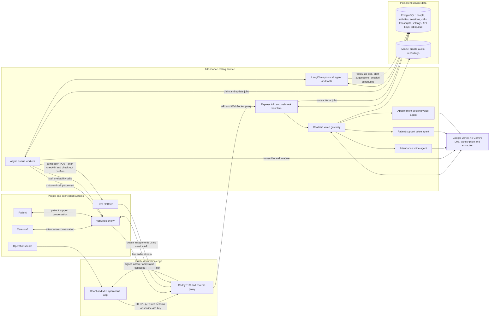

# Outbound attendance calling system

- `backend/` contains the Vobiz, Vertex AI, PostgreSQL, queue, and MinIO service module.
- `frontend/` contains the React + MUI operations UI, using Axios and TanStack React Query.

See [backend/README.md](backend/README.md) for backend integration and setup.

## Application architecture

The service has two coordinated workflows: outbound employee attendance calls and
inbound patient enquiries. PostgreSQL stores operational records and the durable
job queue; MinIO stores private call recordings. Vobiz handles telephony, while
Vertex AI provides live speech and post-call language processing.



### Outbound attendance flow

```mermaid
sequenceDiagram
  autonumber
  participant P as Host platform or operator
  participant API as Service API
  participant DB as PostgreSQL and durable queue
  participant W as Queue workers
  participant V as Vobiz
  participant L as Vertex Live attendance agent
  participant PC as Vertex transcription and LangChain post-call agent
  participant H as Host platform callback

  P->>API: POST assignment with staff, patient, language and UTC schedule
  API->>DB: Validate overlap; save session and enqueue check-in and check-out
  W->>DB: Claim due call job within concurrency limit
  W->>V: Place employee call
  V->>API: Signed answer webhook and media WebSocket
  API->>L: Provide full session context and stage prompt
  L-->>V: Live speech response; exchange employee audio
  V-->>L: Employee audio
  L->>API: End-of-call audio and call outcome
  API->>DB: Save call status and recording metadata
  API->>DB: Enqueue post-call processing
  W->>PC: Transcribe, extract intent and determine next action
  PC->>DB: Save transcript, outcome, audit and next schedule/retry
  Note over W,DB: Unanswered calls and requested callbacks are rescheduled using configurable retry/backoff. Check-out stays part of the same session.
  W->>H: POST completion only after both stages confirm
```

### Inbound patient enquiry and appointment flow

```mermaid
sequenceDiagram
  autonumber
  participant Patient as Patient caller
  participant V as Vobiz
  participant API as Service API and realtime voice gateway
  participant DB as PostgreSQL
  participant Live as Vertex Live patient agent
  participant PC as Transcription and LangChain post-call agent
  participant Booking as Vertex Live appointment coordinator
  participant Worker as Queue workers
  participant Ops as Operations UI

  Patient->>V: Call registered inbound number
  V->>API: Signed inbound answer webhook
  API->>DB: Match caller to patient contact; check non-patient call setting
  API-->>V: Accept supported caller or reject according to setting
  V->>API: Open media WebSocket
  API->>Live: Pass matched patient context and preferred language
  Live-->>Patient: Greet by local time, ask need and requested start time
  Patient-->>Live: Describe care need
  Live->>API: Conversation audio
  API->>DB: Save enquiry and recording reference; enqueue processing
  Worker->>PC: Transcribe and classify activity, time and intent
  PC->>DB: Save transcript, activity duration and available staff suggestions
  Ops->>DB: View enquiry and suggested staff in the UI
  Worker->>Booking: Call suggested staff sequentially to confirm availability
  Booking->>Worker: Available, unavailable, unclear or no answer
  Worker->>DB: Save each attempt; retry next candidate or flag for review
  Worker->>DB: On confirmation, create attendance session and enqueue both stages
```

PostgreSQL is the source of truth for session state, call attempts, schedule and
retry timing, transcripts, staff/patient directories, care activities, API keys,
and durable jobs. Audio is kept in private MinIO storage and is served through
organization-scoped API endpoints. The worker applies the configured retention
period to enquiry data and recordings. See [deployment and security guidance](backend/README.md)
for credentials, callback setup, and retention settings.

For automatic deployments after merges to `main`, see [GitHub Actions VM deployment](docs/github-actions-vm-deploy.md). This requires one-time GCP Workload Identity Federation, OS Login/IAP, and GitHub repository variable setup.

## Deploy on a GCP Linux VM

Docker Compose runs PostgreSQL, private MinIO storage, the API, a one-shot
database migration, the queue worker, the React frontend, and Caddy. Caddy obtains and renews TLS
certificates automatically. Before deployment, reserve a static external IP for
the VM, create a DNS A record for your calling hostname pointing to that IP,
and allow inbound TCP 80 and 443 in the GCP firewall. Do not expose ports 3000,
5432, 9000, or 9001.

Copy `.env.docker.example` to `.env`, replace the local passwords, set your GCP
project and organization ID, and fill the Vobiz credentials. Make
`DATABASE_URL` use the same database password as `POSTGRES_PASSWORD`. Keep the
`.env` file private. Set `VOBIZ_FROM_NUMBER` to your provisioned Vobiz caller ID;
new assignments use it by default, with an optional per-assignment override.
Then, from the project root, run the deployment script
with the hostname from your DNS A record:

```sh
cp .env.docker.example .env
chmod 600 .env
nano .env
chmod +x scripts/deploy-vm.sh
./scripts/deploy-vm.sh calls.example.com
```

The React operations UI is served at `https://<hostname>/`; `/api/*` and
`/healthz` are routed to the backend API. The script writes `PUBLIC_DOMAIN`, `PUBLIC_BASE_URL`, `VOBIZ_ANSWER_URL`, and
`VOBIZ_HANGUP_URL` into `.env`, validates Compose configuration, builds and
starts the services, and checks `https://<hostname>/healthz`. It does not
create DNS records or GCP firewall rules; those must be in place first. Point
Vobiz's answer and status webhooks at the generated HTTPS URLs. Caddy forwards
HTTP and WebSocket upgrades to the API on the VM loopback interface. Operations
API routes are protected by provisioned web accounts and HttpOnly sessions; Vobiz callbacks
are validated by Vobiz signatures.

The API and worker use Docker host networking on the Linux VM so Vertex AI can
obtain Application Default Credentials from the attached VM service account
without a JSON key. Attach a service account with Vertex AI access and enable
the Vertex AI API in the project. Set `GOOGLE_CLOUD_PROJECT` and
`GOOGLE_CLOUD_LOCATION` in `.env`. Set `ATTENDANCE_BACKEND_URL` and its token
before using completed-session delivery; if unset, delivery jobs retry and
eventually enter the queue's dead-letter state.

Creating an assignment queues both check-in and check-out in the same session.
The check-out call waits until `scheduledEndAt`; a terminal result for check-in
does not cancel it. The session is `completed` only after both stages are
confirmed. If either stage exhausts its configured retries or needs review, the
session becomes an exception after both stages have settled.

Compose runs `backend-migrate` before starting the API and worker.

## Dashboard sign-in and account provisioning

The dashboard now requires an email and password. Accounts are created on the VM by an administrator; there is no account-creation page. Sign-in uses a 12-hour HttpOnly, SameSite session cookie, while platform integrations continue using service API keys.

After deployment and database migrations, provision an account interactively:

```sh
read -r -p "Login email: " web_email
read -r -p "Display name: " web_name
read -r -s -p "Password (at least 12 characters): " web_password
printf '\n'
printf '%s\n%s\n%s\n' "$web_email" "$web_name" "$web_password" | sudo docker compose --env-file .env -f docker-compose.yml -f docker-compose.vertex-credentials.yml exec -T backend-api node scripts/create-web-user.js
unset web_password
```

Run the same command to provision additional accounts. The account is scoped to `DEFAULT_ORGANIZATION_ID` and password material is stored as a salted scrypt hash. No API key or admin secret needs to be entered in the dashboard. Use the UI's **Sign out** control to revoke the current session.

Useful operations:

```sh
docker compose logs -f backend-api backend-worker
docker compose restart backend-api backend-worker
docker compose down                 # preserves named database/object volumes
docker compose down -v              # permanently deletes database and recordings
```


## Configure inbound Vobiz calls

After deployment, create a Vobiz Voice Application with the Answer URL `https://<your-domain>/api/call-service/incoming/answer` (POST), Hangup URL `https://<your-domain>/api/call-service/webhooks/call-status` (POST), and link your inbound number to the application. See [backend setup](backend/README.md#inbound-patient-calls-vobiz) for verification, recording, transcript, and retention details.
