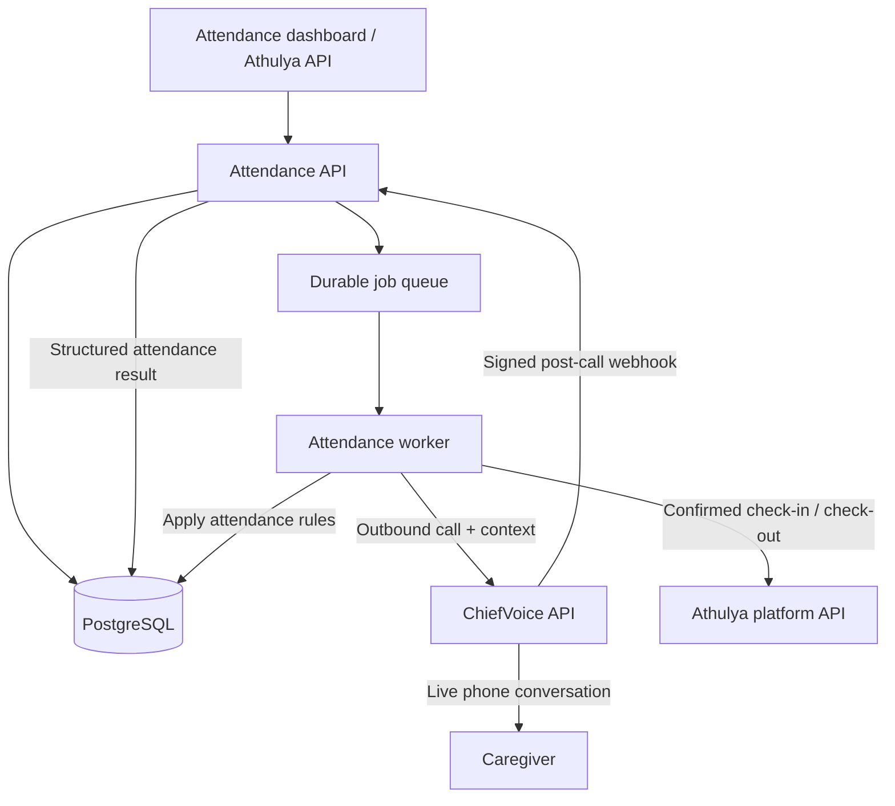

# Athulya Attendance Call Service

An attendance automation service for scheduled caregiver check-in and check-out calls. **ChiefVoice owns telephony, the live voice agent, and post-call extraction.** This repository handles scheduling, retries, attendance policy, audit history, and delivery to the Athulya platform.

## Architecture



The service does not run a local speech model, transcription pipeline, Gemini/Vertex agent, or telephony media bridge. ChiefVoice owns the live conversation and post-call extraction. The attendance app selects the configured ChiefVoice template for each call scenario and supplies operational context. Prompt instructions are managed in ChiefVoice and are not editable in the app.

The live agent receives the caregiver's name for its greeting and schedule context, but no patient name or address. Patient identity and address are sent only in the post-call context so the post-call agent can reconcile the caregiver's answers. The post-call agent should interpret Chennai Thunglish and tolerate partial names, locality-only addresses, and clear agent readbacks confirmed by the caregiver.
## ChiefVoice configuration

Copy `.env.docker.example` to `.env` and configure:

- `CHIEFVOICE_URL` — defaults to `https://core.elvoryx.in`
- `CHIEFVOICE_API_KEY` — bearer API key
- `CHIEFVOICE_TEMPLATE_<SCENARIO>_LIVE_ID` and `CHIEFVOICE_TEMPLATE_<SCENARIO>_POST_CALL_ID` — required scenario-specific templates for `CHECK_IN`, `CHECK_OUT`, `CARE_MANAGER_ESCALATION`, `CHECK_IN_RETRY`, `CHECK_OUT_RETRY`, `CHECK_IN_FOLLOW_UP`, and `CHECK_OUT_FOLLOW_UP`. Each template must be enabled and assigned to the configured API key. The worker sends only the selected scenario's live ID and its separate post-call ID. The shared Compose environment supplies the URL and template map to both API and worker containers.
- `CHIEFVOICE_CALLER_ID` — default E.164 caller ID; organization calling settings can override it
- `ATHULYA_LATE_SCHEDULE_GRACE_MINUTES` — default `2`; if sync arrives after check-in/check-out time by this many minutes or less, queue the call immediately. Admins can change it in **Settings → Calling settings** (0–30; 0 disables late calls).
- `CHIEFVOICE_WEBHOOK_SECRET` — signing secret shared with the webhook registration
- `CHIEFVOICE_WEBHOOK_CALLBACK_URL` — public callback URL, `https://calls.elvoryx.in/api/call-service/webhooks/chiefvoice`
- `CHIEFVOICE_RECORDING_ALLOWED` — defaults to `false`; enable only when recording is explicitly intended
- `CHIEFVOICE_POLL_INITIAL_MS`, `CHIEFVOICE_POLL_INTERVAL_MS`, `CHIEFVOICE_POLL_MAX_ATTEMPTS` — durable status/result polling fallback settings
- `CHIEFVOICE_CALL_FAILURE_MAX_ATTEMPTS` — bounded retries for retryable provider failures; these do not count toward caregiver no-answer escalation

Register the callback in the **same ChiefVoice tenant/API-key scope** used for outbound calls. The API key must have both `calls:write` and `webhooks:write` scopes, and a caller ID assigned to it that matches `CHIEFVOICE_CALLER_ID`. After deploying the attendance service and setting its public URL, load the server-side environment and run:

```bash
set -a; source .env; set +a
curl --fail-with-body -X PUT "$CHIEFVOICE_URL/v1/webhooks/post-call" \
  -H "Authorization: Bearer $CHIEFVOICE_API_KEY" \
  -H "Content-Type: application/json" \
  -d "{\"target_url\":\"$CHIEFVOICE_WEBHOOK_CALLBACK_URL\",\"failure_webhook_url\":\"$CHIEFVOICE_WEBHOOK_CALLBACK_URL\"}"
```

ChiefVoice returns `signing_secret` **once**. Copy that value into `CHIEFVOICE_WEBHOOK_SECRET` in the attendance service's server-side `.env`, then restart the API container. Do not put the secret in the frontend or commit it. If the secret is lost, configure/rotate the callback again in ChiefVoice and update the attendance service with the newly returned secret.

ChiefVoice sends `call.analysis.completed` with `event_id`, `call.session_id`, and the structured post-call object in top-level `result`. It does not include the transcript in this callback. The receiver verifies `X-Chiefvoice-Signature` as HMAC-SHA256 over `timestamp + "." + event_id + "." + exact_raw_request_body`, checks the `X-Chiefvoice-Timestamp` is within five minutes, matches the event ID and type headers to the body, and deduplicates using the event ID. ChiefVoice retries delivery, so the handler is idempotent.

The outbound API request uses `POST /v1/calls/outbound` with bearer API-key authentication (`calls:write`) and an idempotency key. A successful request returns `202` with `session_id` and initial status; the CRM persists these and returns control to the worker without keeping the request open during the conversation. ChiefVoice callback registration uses `PUT /v1/webhooks/post-call` (`webhooks:write`). The CRM can poll `GET /v1/calls/{session_id}` and `GET /v1/calls/{session_id}/post-call` (`calls:read`) if a callback is delayed or missed. Polling uses the same result validation and deduplication path as callbacks. The post-call schema returns the structured attendance verification fields consumed by the deterministic attendance policy. For check-in, the extraction also includes `arrival_status` (`arrived|not_arrived|unclear`), `staff_name`, `patient_name`, `patient_address`, `expected_arrival_time`, `identity_verified`, `follow_up_required`, and `conversation_summary`. The attendance API compares extracted staff/patient/address values against its own directory and requires the explicit `identity_verified` flag before it can confirm check-in; a name alone is not sufficient. `not_arrived` with an expected arrival time is routed into the follow-up workflow. Check-out continues to use the stage-specific departure fields in the same schema.

## Run with Docker

1. Copy `.env.docker.example` to `.env`.
2. Set PostgreSQL and MinIO credentials, `DEFAULT_ORGANIZATION_ID`, the ChiefVoice URL and API key, all 14 scenario-specific template IDs assigned to that key, the webhook secret, and `API_KEY_ADMIN_TOKEN`.
3. Set `PUBLIC_DOMAIN` to the VM's public hostname and make sure DNS points to the VM.
4. Run:

```bash
./scripts/deploy-vm.sh calls.example.com
```

The deployment script writes the public ChiefVoice callback URL into `.env`, validates Compose configuration, starts the stack, and checks `/healthz`.

For local development, install the backend dependencies and run the database migrations before starting the API and worker:

```bash
cd backend
npm ci
npm run migrate
npm run start
```

In a second terminal, run `npm run worker`.

## Attendance processing

- Each assignment creates independent check-in and check-out tasks.
- The worker applies the configured concurrency limit and durable retry policy before placing a call.
- ChiefVoice returns a session/call identifier, which is persisted against the attendance attempt.
- The signed ChiefVoice callback updates call status and stores the structured post-call result.
- The service validates reported times, employee/client verification flags, and the stage-specific outcome before confirming attendance.
- Confirmed events are delivered to the Athulya attendance API with idempotency keys.
- Ambiguous, incomplete, or inconsistent results are sent to human review.

## Important

- Do not commit `.env`, API keys, webhook signing secrets, or provider credentials.
- Configure the live and post-call prompts in ChiefVoice templates; the worker selects the matching template pair for each stage, retry, follow-up, or care-manager escalation and supplies per-call context and the structured output schema.
- The former Vobiz media/webhook runtime and local Gemini/Vertex agent pipeline have been removed. ChiefVoice is used for outbound attendance calls only.
