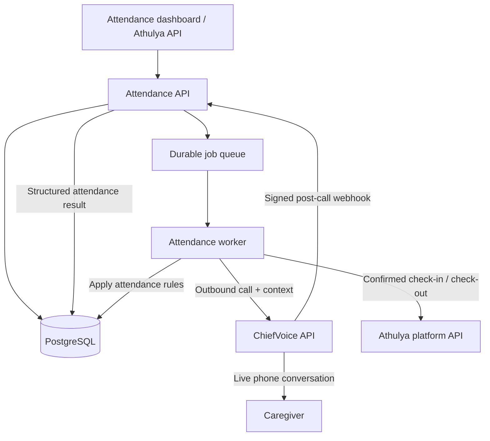

# Athulya Attendance Call Service

An attendance automation service for scheduled caregiver check-in and check-out calls. **ChiefVoice owns telephony, the live voice agent, and post-call extraction.** This repository handles scheduling, retries, attendance policy, audit history, and delivery to the Athulya platform.

## Architecture



The service does not run a local speech model, transcription pipeline, Gemini/Vertex agent, or telephony media bridge. The reusable ChiefVoice templates contain the conversation instructions. Each outbound request supplies the employee, patient, assignment, schedule, language, and attendance stage as context.

## ChiefVoice configuration

Copy `.env.docker.example` to `.env` and configure:

- `CHIEFVOICE_URL` — defaults to `https://chiefvoice.elvoryx.in`
- `CHIEFVOICE_API_KEY` — bearer API key
- `CHIEFVOICE_LIVE_TEMPLATE_ID` — reusable live-agent template
- `CHIEFVOICE_POST_CALL_TEMPLATE_ID` — reusable post-call template
- `CHIEFVOICE_CALLER_ID` — default E.164 caller ID; organization calling settings can override it
- `CHIEFVOICE_WEBHOOK_SECRET` — signing secret shared with the webhook registration
- `CHIEFVOICE_WEBHOOK_CALLBACK_URL` — public callback URL, `https://<domain>/api/call-service/webhooks/chiefvoice`

Register the callback URL with ChiefVoice and configure its webhook signing secret. The endpoint verifies an HMAC-SHA256 signature over the raw request body using the `x-chiefvoice-signature` header (hex or `sha256=<hex>`). Do not expose the signing secret in the frontend.

The outbound API request uses `POST /v1/calls/outbound`, `channel: phone`, `destination`, `caller_id`, `recording_allowed`, `live_agent.template_id/context`, and `post_call.template_id/context/output_schema`. The post-call schema returns the structured attendance verification fields consumed by the deterministic attendance policy.

## Run with Docker

1. Copy `.env.docker.example` to `.env`.
2. Set PostgreSQL and MinIO credentials, `DEFAULT_ORGANIZATION_ID`, the ChiefVoice API key and template IDs, the webhook secret, and `API_KEY_ADMIN_TOKEN`.
3. Set `PUBLIC_DOMAIN` to the VM's public hostname and make sure DNS points to the VM.
4. Run:

```bash
./scripts/deploy-vm.sh calls.example.com
```

The deployment script writes the public ChiefVoice callback URL into `.env`, validates Compose configuration, starts the stack, and checks `/healthz`.

For local development, install the backend dependencies and run the database migrations before starting the API and worker:

```bash
cd backend
npm ci
npm run migrate
npm run start
```

In a second terminal, run `npm run worker`.

## Attendance processing

- Each assignment creates independent check-in and check-out tasks.
- The worker applies the configured concurrency limit and durable retry policy before placing a call.
- ChiefVoice returns a session/call identifier, which is persisted against the attendance attempt.
- The signed ChiefVoice callback updates call status and stores the structured post-call result.
- The service validates reported times, employee/client verification flags, and the stage-specific outcome before confirming attendance.
- Confirmed events are delivered to the Athulya attendance API with idempotency keys.
- Ambiguous, incomplete, or inconsistent results are sent to human review.

## Important

- Do not commit `.env`, API keys, webhook signing secrets, or provider credentials.
- Configure the live and post-call prompts in ChiefVoice templates; this service only supplies per-call context and the structured output schema.
- The former Vobiz media/webhook runtime and local Gemini/Vertex agent pipeline have been removed. ChiefVoice is used for outbound attendance calls only.
