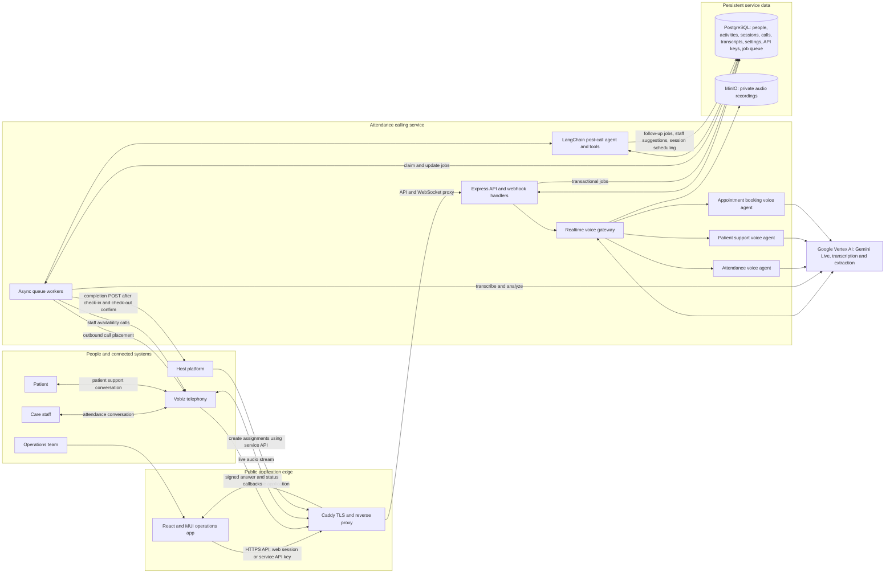
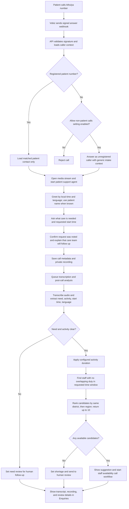
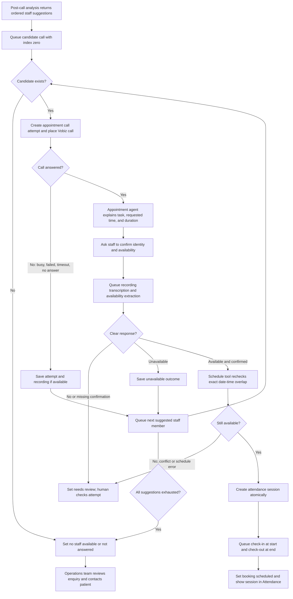
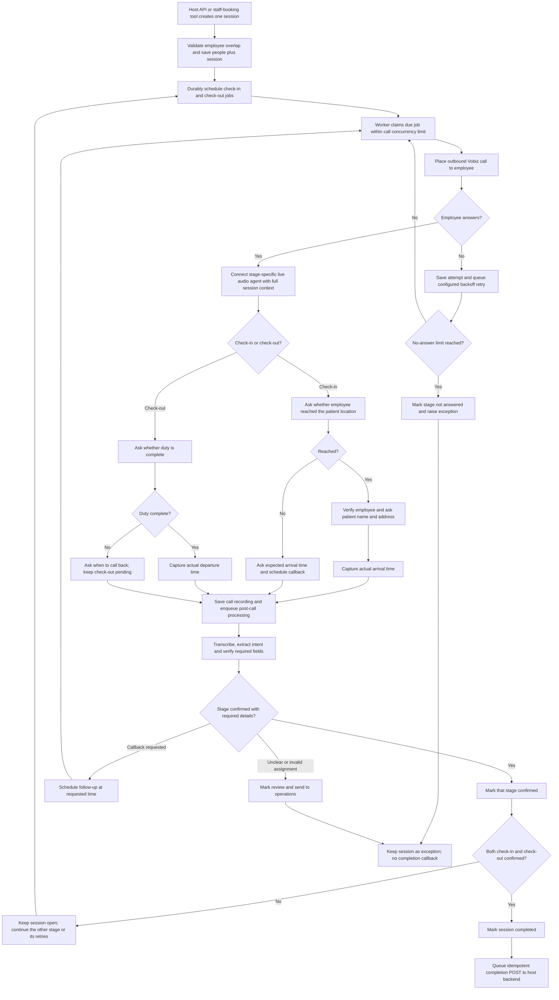

# Outbound attendance calling system

- `backend/` contains the Vobiz, Vertex AI, PostgreSQL, queue, and MinIO service module.
- `frontend/` contains the React + MUI operations UI, using Axios and TanStack React Query.

See [backend/README.md](backend/README.md) for backend integration and setup.

## Application architecture

The service coordinates three voice workflows: inbound patient enquiries,
outbound staff availability confirmation, and employee attendance calls. PostgreSQL stores operational records and the durable
job queue; MinIO stores private call recordings. Vobiz handles telephony, while
Vertex AI provides live speech and post-call language processing.



## Detailed call workflows

The service runs three voice workflows: patient enquiry intake, staff availability
confirmation, and employee attendance verification. Audio capture and call status
updates happen for each voice call; transcription and intent extraction run
asynchronously after the call. The diagrams use decision nodes to show the retry
and human-review outcomes explicitly.

### 1. Inbound patient enquiry



Patient calls use a dedicated patient-support prompt, separate from the staff
attendance prompt. If the caller is not registered and non-patient inbound calls
are disabled, the call is rejected before an agent conversation begins. Activity
aliases map different descriptions of a need to a configured care activity; its
configured duration is used to calculate the duty window from the requested start
without asking the patient for an end time.

### 2. Outbound staff availability confirmation



The appointment coordinator calls candidates one at a time in the post-call
suggestion order. No-answer, busy, failed, timeout, and an explicit unavailable
response advance to the next candidate. An unclear response or missing required
confirmation is marked for human review. A confirmed available response is checked
again against current schedules inside the transaction before the attendance
session is created. If no candidate confirms, the enquiry remains for operations
follow-up and no attendance session is created automatically.

### 3. Outbound employee attendance verification



Check-in requires arrival confirmation, employee verification, patient name and
address verification, and the reported arrival time. A late arrival or requested
callback keeps the stage pending; on a later answered call the agent captures the
actual arrival time. Check-out asks only about duty completion and actual departure
time, without repeating patient-detail questions. Check-in and check-out are
scheduled together in the same session; a failure in one stage does not silently
complete or discard the other. The session completes and is delivered to the host
only when both stages are confirmed. The overdue-call reconciler recovers a missed
due job, while the configured retry limit eventually raises an exception for
human handling.

PostgreSQL is the source of truth for session state, call attempts, schedule and
retry timing, transcripts, staff/patient directories, care activities, API keys,
and durable jobs. Audio is kept in private MinIO storage and is served through
organization-scoped API endpoints. The worker applies the configured retention
period to enquiry data and recordings. See [deployment and security guidance](backend/README.md)
for credentials, callback setup, and retention settings.

For automatic deployments after merges to `main`, see [GitHub Actions VM deployment](docs/github-actions-vm-deploy.md). This requires one-time GCP Workload Identity Federation, OS Login/IAP, and GitHub repository variable setup.

## Deploy on a GCP Linux VM

Docker Compose runs PostgreSQL, private MinIO storage, the API, a one-shot
database migration, the queue worker, the React frontend, and Caddy. Caddy obtains and renews TLS
certificates automatically. Before deployment, reserve a static external IP for
the VM, create a DNS A record for your calling hostname pointing to that IP,
and allow inbound TCP 80 and 443 in the GCP firewall. Do not expose ports 3000,
5432, 9000, or 9001.

Copy `.env.docker.example` to `.env`, replace the local passwords, set your GCP
project and organization ID, and fill the Vobiz credentials. Make
`DATABASE_URL` use the same database password as `POSTGRES_PASSWORD`. Keep the
`.env` file private. Set `VOBIZ_FROM_NUMBER` to your provisioned Vobiz caller ID;
new assignments use it by default, with an optional per-assignment override.
Then, from the project root, run the deployment script
with the hostname from your DNS A record:

```sh
cp .env.docker.example .env
chmod 600 .env
nano .env
chmod +x scripts/deploy-vm.sh
./scripts/deploy-vm.sh calls.example.com
```

The React operations UI is served at `https://<hostname>/`; `/api/*` and
`/healthz` are routed to the backend API. The script writes `PUBLIC_DOMAIN`, `PUBLIC_BASE_URL`, `VOBIZ_ANSWER_URL`, and
`VOBIZ_HANGUP_URL` into `.env`, validates Compose configuration, builds and
starts the services, and checks `https://<hostname>/healthz`. It does not
create DNS records or GCP firewall rules; those must be in place first. Point
Vobiz's answer and status webhooks at the generated HTTPS URLs. Caddy forwards
HTTP and WebSocket upgrades to the API on the VM loopback interface. Operations
API routes are protected by provisioned web accounts and HttpOnly sessions; Vobiz callbacks
are validated by Vobiz signatures.

The API and worker use Docker host networking on the Linux VM so Vertex AI can
obtain Application Default Credentials from the attached VM service account
without a JSON key. Attach a service account with Vertex AI access and enable
the Vertex AI API in the project. Set `GOOGLE_CLOUD_PROJECT` and
`GOOGLE_CLOUD_LOCATION` in `.env`. Set `ATTENDANCE_BACKEND_URL` and its token
before using completed-session delivery; if unset, delivery jobs retry and
eventually enter the queue's dead-letter state.

Creating an assignment queues both check-in and check-out in the same session.
The check-out call waits until `scheduledEndAt`; a terminal result for check-in
does not cancel it. The session is `completed` only after both stages are
confirmed. If either stage exhausts its configured retries or needs review, the
session becomes an exception after both stages have settled.

Compose runs `backend-migrate` before starting the API and worker.

## Dashboard sign-in and account provisioning

The dashboard accepts a phone number for Care Manager accounts and email for Admin accounts. Accounts are created on the VM by an administrator; there is no public account-creation page. Sign-in uses a 12-hour HttpOnly, SameSite session cookie, while platform integrations continue using service API keys. Bulk-provisioned Care Managers must replace the administrator-supplied temporary password with a password of at least 12 characters before they can use the application. The temporary password is hashed with a unique salt, supplied privately at provisioning time, and never printed or stored in the repository.

After deployment and database migrations, provision an account interactively:

```sh
read -r -p "Login email: " web_email
read -r -p "Display name: " web_name
read -r -s -p "Password (at least 12 characters): " web_password
printf '\n'
printf '%s\n%s\n%s\n' "$web_email" "$web_name" "$web_password" | sudo docker compose --env-file .env -f docker-compose.yml -f docker-compose.vertex-credentials.yml exec -T backend-api node scripts/create-web-user.js
unset web_password
```

Run the same command to provision additional Admin accounts. The account is scoped to `DEFAULT_ORGANIZATION_ID` and password material is stored as a salted scrypt hash. Admin accounts are created only from the VM console. No API key or admin secret needs to be entered in the dashboard.

To provision Care Manager accounts from a JSON file on the VM, prepare records with `athulyaCareManagerId`, `name`, and `phone` fields, restrict the file to the service user, and pass the approved record count into the script. It creates and links accounts in one database transaction; if any ID or phone is already linked, the whole batch stops without partial creation:

```sh
sudo chmod 600 /tmp/care-managers.json
read -r -s -p "Temporary Care Manager password: " cm_temp_password
printf '\n'
sudo docker compose --env-file .env -f docker-compose.yml -f docker-compose.vertex-credentials.yml exec -T \
  -e CARE_MANAGER_PROVISION_EXPECTED_COUNT=16 -e CARE_MANAGER_DEFAULT_PASSWORD="$cm_temp_password" backend-api \
  node scripts/provision-care-manager-accounts.js < /tmp/care-managers.json
unset cm_temp_password
sudo rm -f /tmp/care-managers.json
```

Replace `16` with the count you have approved. Phone numbers may be entered as 10 digits or with the `+91` country code. The sign-in form accepts either form. After signing in with the temporary password, each Care Manager must set a new password; backend API access stays blocked until the change is complete. Later, an Admin can reset an account from the **Care Managers** screen, which again requires the Care Manager to change the temporary password.

Admins manage Care Manager account status and password resets in **Care Managers**; Care Manager access is enforced in backend routes as well as the navigation. Configure the Athulya schedule integration in **Settings → Athulya integration**. Before entering an API key, add a stable `ATHULYA_CREDENTIALS_ENCRYPTION_KEY` to the VM `.env` (generate a 32-byte hex value with `openssl rand -hex 32`). The key is encrypted at rest and masked in the UI. See [backend integration details](backend/README.md#athulya-workforce-integration).

Only the schedule fetch endpoint is documented. Attendance export remains `Awaiting API Specification` and is intentionally not sent until Athulya provides the official check-in/check-out API contract.

Useful operations:

```sh
docker compose logs -f backend-api backend-worker
docker compose restart backend-api backend-worker
docker compose down                 # preserves named database/object volumes
docker compose down -v              # permanently deletes database and recordings
```


## Configure inbound Vobiz calls

After deployment, create a Vobiz Voice Application with the Answer URL `https://<your-domain>/api/call-service/incoming/answer` (POST), Hangup URL `https://<your-domain>/api/call-service/webhooks/call-status` (POST), and link your inbound number to the application. See [backend setup](backend/README.md#inbound-patient-calls-vobiz) for verification, recording, transcript, and retention details.
